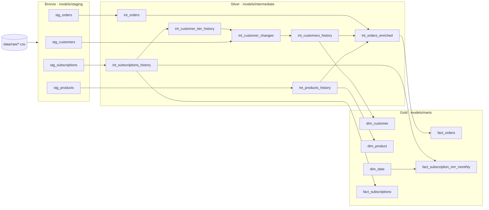
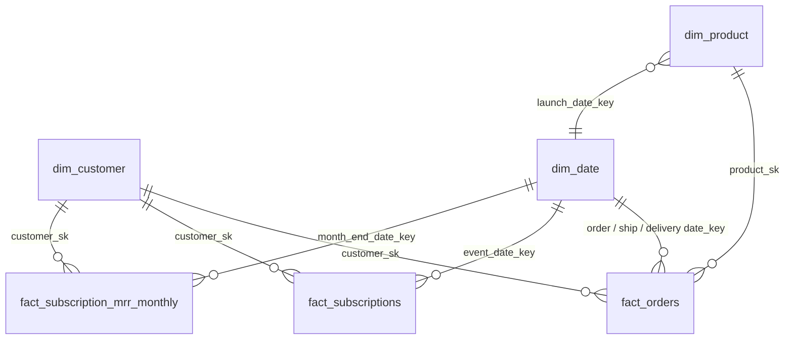

# ecom-data-modeling-project

A data modeling project for a fictional e-commerce business, built with dbt and DuckDB.

The raw data is synthetic. A Python script generates it with a realistic change history, including updates, corrections, late-arriving rows and duplicates, so the dbt models have to handle what real source extracts look like.

## Setup

Requires Python 3.11+ and [uv](https://docs.astral.sh/uv/). Dependencies are declared in `pyproject.toml` and pinned in `uv.lock`.

```bash
export UV_PROJECT_ENVIRONMENT=deenv   # put the virtualenv in ./deenv instead of ./.venv
uv sync                               # installs project + dev tools (ruff, flake8, black)
source deenv/bin/activate
```

Code quality checks:

```bash
ruff check .
flake8 scripts
black --check .
```

## Generating the raw data

```bash
python scripts/generate_raw_data.py
```

This writes four CSVs to `data/raw/`. The output is reproducible: the same `--seed` and options always produce the same files, so `data/` is not committed.

| Option | Default | Meaning |
|---|---|---|
| `--customers` | 1000 | Number of customers |
| `--products` | 80 | Number of products |
| `--orders` | 6000 | Number of orders |
| `--subscription-share` | 0.35 | Share of customers who start a subscription |
| `--start` / `--end` | 2024-01-01 / 2026-10-31 | Date range of the history |
| `--late-rate` | 0.03 | Share of rows that load 1–14 days late |
| `--dup-rate` | 0.01 | Share of rows delivered twice |
| `--seed` | 42 | Random seed |
| `--out-dir` | `data/raw` | Output folder |

Example for a larger dataset:

```bash
python scripts/generate_raw_data.py --customers 5000 --orders 30000 --seed 7
```

## The raw data

Each file is an append-only extract, as if copied nightly from the source system. Every change to a record is a **new row**; nothing is edited in place. To get the current state of a record you have to pick its latest version.

Every file has three metadata columns:

| Column | Meaning |
|---|---|
| `updated_at` | When the change happened in the source system |
| `_op` | `I` insert, `U` update, `D` delete |
| `_loaded_at` | When the row landed in the warehouse (a nightly batch around 02:00) |

### Files

| File | Key | One row per | Main columns |
|---|---|---|---|
| `customers.csv` | `customer_id` | customer version | name, email, phone, address, segment, marketing opt-in |
| `products.csv` | `product_id` | product version | SKU, name, category, unit price, active flag |
| `orders.csv` | `order_id` | order status change | customer, product, quantity, price, discount, total, status |
| `subscriptions.csv` | `subscription_id` | subscription version | customer, plan, billing period, MRR, status, start/cancel dates |

Orders contain one product each. Orders and subscriptions reference customers and products by ID.

### What's in the history

- **Updates:**
  - Customers move, change email, phone or last name, toggle marketing opt-in, and move up a segment.
  - Product prices change, and some products are discontinued.
  - Orders go `placed` → `shipped` → `delivered`, or are `cancelled`. Some are later `returned` or get a goodwill discount.
  - Subscriptions go `trialing` → `active`, upgrade or downgrade, become `past_due` or `paused`, and churn to `cancelled`. All live subscriptions are repriced once when plan prices go up.
- **Corrections:** a wrong value is written, then fixed. Examples are a product price with a shifted decimal point, typos in names, an uppercase email with spaces, a wrong state, an order with the wrong quantity, and a backdated subscription start date. About 30% of fixes have the **same `updated_at`** as the bad row, so only `_loaded_at` tells you which one is newer.
- **Late arrivals:** about 3% of rows load 1–14 days after they happened, so rows can arrive out of order.
- **Duplicates:** about 1% of rows are delivered twice, either identically or in a later batch.
- **Deletes:** about 2% of customers are hard-deleted (`_op = 'D'`), and their live subscriptions are cancelled first. A few discontinued products are deleted too.
- **Unfixed messy values:** some emails keep odd capitalization, phone formats vary, and about 5% of phones are missing.
- **Cutoff:** the data is an extract taken on the morning after `--end`. Anything not yet loaded by then is missing, so recent orders can still be open.

### Picking the latest version

To deduplicate, order each key's rows by `updated_at` and then `_loaded_at`, both descending. For example:

```sql
select *
from raw_customers
qualify row_number() over (
    partition by customer_id
    order by updated_at desc, _loaded_at desc
) = 1
```

Drop the result if that latest row has `_op = 'D'`.

## Architecture

The dbt project follows a medallion layout. Each layer is a folder under `models/` and a schema in `ecom.duckdb`.



| Layer | Schema | Built as | Grain | What happens |
|---|---|---|---|---|
| **Bronze** (staging) | `bronze` | views | one row per record change | Cast types, trim and standardize text (emails, phones, states), turn blanks into nulls, flag deletes. Deduplicate to one row per (key, `updated_at`), keeping the row loaded last, which removes duplicate deliveries and applies same-timestamp corrections. |
| **Silver** (intermediate) | `silver` | tables | one row per version / per order | Build SCD Type 2 history (`valid_from_timestamp`, `valid_to_timestamp`, `is_current`) with the `scd2_from_history` macro. Roll order changes up to one row per order with lifecycle timestamps. Join each order to the customer and product versions valid when it was placed. |
| **Gold** (marts) | `gold` | tables | one row per declared grain | Kimball star schema: three dimensions and three facts. See [Star schema](#star-schema-gold-layer). |

### Key design choices

- **SCD2 is derived from the source history, not from dbt snapshots.** The extracts already contain every change with its timestamp, so versions are rebuilt from scratch on each run. Snapshots would only capture changes seen between dbt runs.
- **A version starts only when a tracked value changes.** Rows that repeat the same values are collapsed.
- **Deletes close the history.** A hard delete becomes a tombstone version in Silver. Gold removes it, so the customer's last version ends at the delete time and its history stays available for old orders.
- **Point-in-time joins.** `fact_orders.customer_sk` points to the customer as they were when the order was placed, such as their segment and state at that time. For current attributes, join `dim_customer` on `customer_id` with `is_current`.
- **MRR** counts only `active` and `past_due` subscriptions. Trials and paused subscriptions show 0.
- **Kimball naming in Gold.** Dimensions are singular (`dim_customer`, `dim_product`, `dim_date`) and facts are prefixed `fact_`.

### Where each data problem is handled

| Problem in the raw data | Handled in | How |
|---|---|---|
| Everything arrives as text | Bronze | Explicit casts to timestamp, date, decimal, integer and boolean |
| Blank strings, missing values | Bronze | `nullif(trim(x), '')`; missing country defaults to `US` |
| Messy emails | Bronze | Lowercased and trimmed |
| Many phone formats | Bronze | Digits only, US country code (`1` / `001`) removed, extension split into `phone_extension` |
| Duplicate deliveries | Bronze | One row per (key, `updated_at`), latest `_loaded_at` wins |
| Corrections with the same `updated_at` | Bronze | Same rule: the row loaded later is the fix |
| Corrections with a later `updated_at` | Silver | Become a new SCD2 version |
| Late-arriving rows | Silver | Versions are ordered by `updated_at`, not by load time |
| Hard deletes (`_op = 'D'`) | Silver → Gold | Tombstone version in Silver, removed in Gold; `deleted_at` kept on every version |
| Orders still open at the cutoff | Silver | `is_open` flag; lifecycle timestamps stay null |

## SCD Type 2: `dim_customer`

### The problem

Customers change their email, move, get upgraded to a new segment, and switch subscription plans. If `dim_customer` held one row per customer and overwrote it on every change, every past order would report the customer's *current* profile. A 2024 order from a small-business customer on the basic plan would be reported as an enterprise order today.

In this dataset that error is not small. Comparing each order's profile at order time with the customer's latest profile (`analyses/customer_profile_at_order_vs_today.sql`):

| Orders | Segment differs | Tier differs | State differs | Email differs | Any of these differs |
|---|---|---|---|---|---|
| 5,998 | 429 | 559 | 761 | 211 | **1,671 (28%)** |

### The implementation

`dim_customer` keeps one row per **version** of a customer:

| Column | Meaning |
|---|---|
| `customer_sk` | Surrogate key of the version. Facts join on this. |
| `customer_id` | Natural key, the same for every version of a customer |
| `valid_from_timestamp` | When this version became true |
| `valid_to_timestamp` | When the next version replaced it. Null for the current version. Intervals are half-open: `[from, to)`. |
| `is_current` | True for the latest version |
| `version_number` | 1, 2, 3 … |
| `deleted_at`, `is_deleted_customer` | Set on every version of a customer that was later hard-deleted |

Tracked attributes are name, email, phone, address, segment, marketing opt-in and **subscription tier**. A change to any of them starts a new version.

How it is built:

1. **Bronze** (`stg_customers`) gives one clean row per customer change.
2. **Tier timeline** (`int_customer_tier_history`): subscription tier lives in a different source table, so it gets its own timeline first. The tier is the plan of the customer's live subscription, or `none`.
3. **Merging the timelines** (`int_customer_changes`): every moment either the profile or the tier changed becomes a change point. At each point, two DuckDB `ASOF JOIN`s look up the profile row and the tier that were in effect at that moment.
4. **Versioning** (`scd2_from_history` macro): hash the tracked columns, drop rows whose hash equals the previous row's, then use `lead()` to set `valid_to_timestamp` to the next version's start.

Example: customer C00063's tier moves basic → plus → basic → none, then their segment changes. Each order keeps the profile from the day it was placed:

| Version | Segment | Tier | Valid from | Valid to |
|---|---|---|---|---|
| 1 | small_business | none | 2024-01-06 | 2024-03-09 |
| 2–3 | small_business | basic | 2024-03-09 | 2025-05-01 |
| 4 | small_business | plus | 2025-05-01 | 2025-08-29 |
| 5 | small_business | basic | 2025-08-29 | 2025-09-29 |
| 6 | small_business | none | 2025-09-29 | 2026-08-11 |
| 7 | enterprise | none | 2026-08-11 | *(current)* |

Their order from October 2024 reports `basic` / `small_business`, not today's `none` / `enterprise`. (Between versions 2 and 3 they opted in to marketing.)

### Querying it

Profile at the moment of the order: join on the surrogate key, which `fact_orders` already resolved.

```sql
select o.order_id, o.order_placed_at, c.customer_segment, c.subscription_tier, c.state
from gold.fact_orders o
join gold.dim_customer c on c.customer_sk = o.customer_sk;
```

Profile at any other point in time: join on the natural key and the validity window.

```sql
select *
from gold.dim_customer
where customer_id = 'C00063'
  and timestamp '2025-06-01' >= valid_from_timestamp
  and (timestamp '2025-06-01' < valid_to_timestamp or valid_to_timestamp is null);
```

Today's profile: `where is_current`.

### Why custom SQL instead of dbt snapshots

dbt snapshots record what a table looks like **each time dbt runs**. They suit sources that only hold the current state of a record. Here the extracts already contain the full change log with timestamps, so the history can be rebuilt exactly from the source:

| | Custom SQL from the change log (used here) | dbt snapshots |
|---|---|---|
| Validity times | When the change happened in the source (`updated_at`) | When dbt happened to run |
| Changes between runs | All kept | Only the last state seen per run |
| Late-arriving rows | Placed at the right point in history on the next rebuild | Recorded as new changes, out of order |
| Backfill and fixes to logic | Rebuild with `dbt build` | History can't be recreated if the source no longer has it |
| Merging two sources (profile + tier) | Straightforward | Needs a snapshot of a pre-joined model |
| Cost | Full rebuild each run (fine at this size; can be made incremental) | Incremental by design |

Snapshots would be the right choice if the source only exposed the current state of each customer.

### How it is tested

- `scd2_valid_ranges` (generic test, applied to `dim_customer` and every Silver history model): each customer's versions are contiguous (no gaps or overlaps), only the last is open-ended and marked current, and a deleted customer's last version ends exactly at the delete.
- `assert_orders_join_customer_version_at_order_time`: every order's `customer_sk` points to a version whose window contains `order_placed_at`.
- Unique and not-null `customer_sk`, and allowed values for `subscription_tier`.

## Star schema (Gold layer)



### Bus matrix

Which dimensions each business process (fact) uses:

| Fact | Grain | Type | `dim_date` | `dim_customer` | `dim_product` |
|---|---|---|---|---|---|
| `fact_orders` | order line | transaction | order, ship, delivery | ✓ (at order time) | ✓ (at order time) |
| `fact_subscriptions` | MRR movement or churn event | transaction | event | ✓ (at event time) | |
| `fact_subscription_mrr_monthly` | subscription × month | periodic snapshot | month end | ✓ (at month end) | |

All three facts share `dim_customer` and `dim_date` (conformed dimensions), so orders and subscriptions can be analyzed side by side for the same customers and dates.

### `dim_date`

One row per day from `date_spine_start` to `date_spine_end` (vars in `dbt_project.yml`).

| Group | Columns |
|---|---|
| Keys | `date_key` (yyyymmdd integer), `date_day` |
| Calendar | `year`, `quarter`, `month`, `month_name`, `year_month`, `day_of_month`, `day_of_year`, `iso_week`, `day_name`, `week_start`, `month_start`, `month_end`, `quarter_start`, `is_month_end`, `is_quarter_end` |
| Fiscal | `fiscal_year`, `fiscal_quarter`, `fiscal_month`, `fiscal_year_name` (`FY2026`), `fiscal_quarter_name` (`FY2026-Q1`) |
| Weekends and holidays | `is_weekend`, `holiday_name`, `is_holiday`, `observed_holiday_name`, `is_observed_holiday`, `is_business_day` |
| Retail events | `retail_event_name`, `is_retail_event` (Black Friday, Cyber Monday) |
| Rolling windows | `as_of_date`, `days_from_as_of`, `months_from_as_of`, `is_future`, `is_last_7_days`, `is_last_30_days`, `is_last_90_days`, `is_last_365_days`, `is_current_month`, `is_previous_month`, `is_month_to_date`, `is_year_to_date`, `is_prior_year_to_date`, `is_fiscal_year_to_date` |

- **Fiscal year** starts in the month set by `fiscal_year_start_month` (default 2, February, as many retailers use). Fiscal years are named by the calendar year they end in: FY2026 runs Feb 2025 – Jan 2026. Set it to 1 for a calendar fiscal year.
- **Holidays** are the 11 US federal holidays, computed from their rules (for example, Thanksgiving is the 4th Thursday of November), so no seed file needs maintaining. A holiday on a Saturday is observed on Friday and one on a Sunday on Monday. `is_business_day` excludes weekends and observed holidays.
- **Rolling windows** are relative to `as_of_date`. By default that is the last order date in the data (2026-10-31), so "last 30 days" means the last 30 days of data, not of the wall clock. Set `as_of_date` to pin it: `dbt build --vars '{as_of_date: "2026-06-30"}'`.

### `dim_product`

SCD Type 2, one row per product version: a price change or discontinuation starts a new version.

| Group | Columns |
|---|---|
| Keys | `product_sk`, `product_id`, `sku` |
| Attributes | `product_name`, `product_line` (Deluxe Tent), `product_style` (Deluxe), `product_type` (Tent), `color`, `category`, `category_code` (SKU prefix) |
| Pricing | `unit_price`, `currency`, `price_band` |
| Lifecycle | `is_active`, `launched_at`, `launch_date`, `launch_date_key`, `discontinued_at`, `discontinued_date_key`, `deleted_at`, `is_deleted_product` |
| SCD2 | `version_number`, `valid_from_timestamp`, `valid_to_timestamp`, `is_current` |

Launch and discontinuation dates belong to the product, not the version, so they repeat on every version.

### `fact_orders`

**Grain: one row per order line.** The source sells one product per order, so each order has one line (`order_line_number = 1`, `order_line_id = <order_id>-1`). Keying on the line means multi-product orders would fit without a redesign.

| Kind | Columns |
|---|---|
| Dimension keys | `customer_sk`, `product_sk` (versions valid when the order was placed), `order_date_key`, `ship_date_key`, `delivery_date_key` |
| Degenerate dimension | `order_id`, `order_line_number` |
| Additive measures | `quantity`, `gross_revenue`, `discount_amount`, `net_revenue`, `cancelled_revenue`, `returned_revenue`, `recognized_revenue` |
| Non-additive | `unit_price`, `discount_pct`, `days_to_ship`, `days_to_deliver` |
| Attributes and flags | `order_status`, `payment_method`, `currency`, `is_open`, `is_cancelled`, `is_returned`, lifecycle timestamps |

The revenue measures add up: `gross_revenue − discount_amount = net_revenue` and `net_revenue − cancelled_revenue − returned_revenue = recognized_revenue`.

`dim_date` is a **role-playing dimension** here: the same table is joined three times, as order date, ship date and delivery date. Ship and delivery keys are null until those events happen.

### `fact_subscriptions`

**Grain: one row per subscription change that moves MRR or cancels the subscription.** Summing `mrr_change` over every event up to a date gives MRR on that date. A test checks this against the monthly snapshot for all 34 months.

Paying MRR is `mrr` while the subscription is `active` or `past_due`, and 0 otherwise. Each event gets a `movement_type`:

| `movement_type` | Meaning | MRR |
|---|---|---|
| `new` | First time the subscription pays (direct start or trial conversion) | + |
| `expansion` | Upgrade or price increase while paying | + |
| `contraction` | Downgrade while paying | − |
| `pause` | Paying → paused | − |
| `resume` | Paused → paying | + |
| `reactivation` | Paying again after any other non-paying state | + |
| `churn` | Paying → cancelled | − |
| `no_mrr_change` | Cancellation of a subscription that wasn't paying (a trial) | 0 |

Churn events are flagged separately (`is_churn_event`, `churned_subscriptions` = 1) with `churn_type`: `paid`, `trial` or `paused`. A trial that never converts counts as churn with no MRR lost.

| Kind | Columns |
|---|---|
| Keys | `subscription_event_id`, `subscription_id` (degenerate), `customer_sk`, `event_date_key` |
| Additive measures | `mrr_change`, `mrr_gained`, `mrr_lost`, `churned_subscriptions` |
| Semi-additive | `mrr_before`, `mrr_after`: balances, so don't sum them across events |
| Context | `movement_type`, `status_before`, `status_after`, `plan_before`, `plan_after`, `billing_period`, `churn_type` |

`fact_subscription_mrr_monthly` is the matching **periodic snapshot**: MRR per subscription at each month end. Use it for "MRR in month X" and use `fact_subscriptions` for "why MRR changed". Its `mrr` is semi-additive: sum across subscriptions, never across months.

### Star schema design choices

- **Grain first.** Every fact states its grain in its model and YAML, and has a test that it is unique at that grain.
- **Attributes live in dimensions.** Facts carry keys and measures. Attributes such as segment or tier at the time of the order come from joining `dim_customer` on `customer_sk`, which already points to the right version.
- **Low-cardinality order attributes** (`order_status`, `payment_method`, `currency`) stay on the fact rather than in a separate junk dimension. With three small columns, an extra join adds little.
- **Null date keys** mean "hasn't happened yet" (not shipped, not delivered). The alternative is an "unknown" row with key −1 in `dim_date`. It wasn't needed here because every customer and product key always resolves.

## Model reference

### Bronze (`models/staging`)

| Model | Key | Notes |
|---|---|---|
| `stg_customers` | `customer_id`, `updated_at` | Keeps `phone_raw` next to the cleaned `phone_number`. `postal_code` stays text to keep leading zeros. |
| `stg_products` | `product_id`, `updated_at` | Price as `decimal(10,2)`. |
| `stg_orders` | `order_id`, `updated_at` | `status` renamed to `order_status`. |
| `stg_subscriptions` | `subscription_id`, `updated_at` | Date-only columns renamed `started_on`, `trial_ends_on`. |

Every Bronze model also has `source_operation` (the raw `_op`), `is_deleted` and `loaded_at`. The raw CSVs are read through the `raw` source in `models/staging/_sources.yml`.

### Silver (`models/intermediate`)

| Model | Grain | Notes |
|---|---|---|
| `int_customer_tier_history` | customer tier period | Subscription tier over time (`none`, `basic`, `plus`, `premium`) |
| `int_customer_changes` | customer change point | Ephemeral: profile and tier timelines merged into one change stream |
| `int_customers_history` | customer version | SCD2 over name, email, phone, address, segment, marketing opt-in and subscription tier |
| `int_products_history` | product version | SCD2 over SKU, name, category, price, active flag |
| `int_subscriptions_history` | subscription version | SCD2 over plan, billing period, MRR, status, dates |
| `int_orders` | order | Latest state plus `shipped_at`, `delivered_at`, `cancelled_at`, `returned_at` (first time each status was reached), gross, discount and net amounts |
| `int_orders_enriched` | order | `int_orders` + `customer_sk`, `product_sk`, segment, state, subscription tier, category and list price at order time |

The three history models share these columns from the `scd2_from_history` macro:

| Column | Meaning |
|---|---|
| `*_sk` | Surrogate key of the version: hash of the record key and `valid_from_timestamp` |
| `valid_from_timestamp` / `valid_to_timestamp` | When the version was true; `valid_to_timestamp` is null for the latest version |
| `is_current` | Latest version of the record |
| `version_number` | 1, 2, 3 … per record |
| `is_deleted` | Tombstone version recording a delete |
| `deleted_at` | When the record was deleted, repeated on every version |

To track another column in the history, add it to `tracked_columns` in the model that calls the macro.

### Gold (`models/marts`)

| Model | Grain | Main columns |
|---|---|---|
| `dim_customer` | customer version | `customer_sk`, `customer_id`, `full_name`, contact and address, `customer_segment`, `subscription_tier`, `valid_from_timestamp`, `valid_to_timestamp`, `is_current`, `is_deleted_customer` |
| `dim_product` | product version | `product_sk`, `product_id`, `sku`, name parts, `category`, `unit_price`, `price_band`, `launch_date`, `discontinued_at`, validity columns |
| `dim_date` | day | Calendar, fiscal, holiday, retail-event and rolling-window columns. See [`dim_date`](#dim_date). |
| `fact_orders` | order line | Dimension keys (customer, product, order/ship/delivery date), `quantity`, `gross_revenue`, `discount_amount`, `net_revenue`, `cancelled_revenue`, `returned_revenue`, `recognized_revenue`, lifecycle timestamps |
| `fact_subscriptions` | MRR movement / churn event | `customer_sk`, `event_date_key`, `movement_type`, `mrr_change`, `mrr_gained`, `mrr_lost`, `churned_subscriptions`, `churn_type` |
| `fact_subscription_mrr_monthly` | subscription × month | `month_start`, `customer_sk`, plan, status, `mrr`, `is_paying`. Cancelled subscriptions appear up to their cancellation month. |

## Testing and documentation

`dbt build` runs **145 data tests and 2 unit tests** alongside the 16 models. Each test runs right after the model it checks, so a failure stops bad data before it reaches anything downstream.

### Test strategy by layer

| Layer | What is tested |
|---|---|
| **Sources** | Keys and `updated_at` not null, `_op` in (I, U, D), and freshness of `_loaded_at` (`dbt source freshness`) |
| **Bronze** | One row per (key, `updated_at`), not-null keys, allowed values for every status and category column, non-negative amounts, `discount_pct` between 0 and 1 |
| **Silver** | Unique surrogate keys, valid SCD2 ranges on every history model, one row per order, non-negative order totals |
| **Gold** | Each fact unique at its grain, referential integrity from every fact key to its dimension, valid SCD2 ranges on both SCD2 dimensions, non-negative measures, revenue and MRR components that add up, cross-fact reconciliation |

### Test types

| Type | Count | Used for |
|---|---|---|
| `not_null` | 62 | Keys and required columns |
| `not_negative` (custom generic) | 20 | Order totals, revenue, quantities, prices and MRR never drop below zero |
| `accepted_values` | 16 | Statuses, segments, categories, plans, movement and churn types |
| `unique` | 12 | Surrogate and natural keys |
| `relationships` | 10 | Every fact foreign key exists in its dimension |
| `expression_is_true` (custom generic) | 8 | Row-level rules: `gross − discount = net`, `delivered ≥ shipped`, `mrr_after − mrr_before = mrr_change` |
| `unique_combination_of_columns` (custom generic) | 7 | Composite keys and fact grain |
| `scd2_valid_ranges` (custom generic) | 6 | SCD2 validity ranges never overlap and have no gaps |
| Singular tests | 4 | One-off cross-model checks (below) |
| Unit tests | 2 | Logic checked against hand-made inputs (below) |

### Custom generic tests (`tests/generic/`)

Reusable tests that any model can use from YAML:

- **`not_negative`**: fails for every row where the column is below zero. It guards `net_revenue` (the order total), `gross_revenue`, `discount_amount`, the cancelled, returned and recognized revenue columns, `quantity`, `unit_price` and all MRR columns.
- **`scd2_valid_ranges`**: for each entity in an SCD2 table, checks that:
  1. every version ends after it starts
  2. no two versions overlap
  3. there are no gaps between versions (optional)
  4. at most one version is open-ended, and it is the last
  5. the `is_current` flag matches (optional)
  6. a deleted entity's last version ends at the delete (optional)

  It returns one row per problem with a description. Applied to `dim_customer`, `dim_product`, and all four Silver history models.
- **`expression_is_true`**: fails for rows where a SQL expression isn't true. Use it for rules that span columns.
- **`unique_combination_of_columns`**: composite-key uniqueness.

To make sure these tests don't pass vacuously, they were run against copies of the data with an overlap, a gap and a negative order total injected. Each problem was caught.

```yaml
# models/marts/_marts.yml
- name: dim_customer
  data_tests:
    - scd2_valid_ranges:
        arguments:
          entity_key: customer_id
          current_flag: is_current
          deleted_at: deleted_at
  columns:
    - name: customer_sk
      data_tests: [unique, not_null]

- name: fact_orders
  columns:
    - name: net_revenue
      data_tests: [not_null, not_negative]
    - name: customer_sk
      data_tests:
        - relationships:
            arguments:
              to: ref('dim_customer')
              field: customer_sk
```

### Singular tests (`tests/`)

- `assert_orders_join_customer_version_at_order_time`: every order points to the customer version valid when it was placed.
- `assert_order_totals_reconcile`: `net_revenue` = quantity × unit price × (1 − discount), to the cent.
- `assert_mrr_movements_reconcile_to_snapshot`: for every month, the MRR movements in `fact_subscriptions` sum to the MRR in `fact_subscription_mrr_monthly`.
- `assert_dim_date_holidays`: each full year has 11 federal holidays, Thanksgiving is the 4th Thursday of November, and Black Friday follows it.

### Unit tests (`models/marts/_unit_tests.yml`)

dbt unit tests run a model's SQL on small hand-written inputs and compare the output with expected rows:

- `fact_subscriptions_classifies_every_movement_type`: one subscription goes through trial → paid → upgrade → past due → pause → resume → downgrade → cancel, and another is a trial that never converts. Every change must get the right movement type and MRR change.
- `int_orders_rolls_up_lifecycle_and_corrections`: an order is placed with the wrong quantity, corrected, shipped, delivered and returned. The roll-up must keep the corrected quantity and record when each status was first reached.

Run only these with `dbt test --select test_type:unit`.

### Severity and debugging failures

- **Errors vs. warnings.** Most tests fail the build. `delivered_orders_have_ship_event` is set to `severity: warn`. It reports orders whose "delivered" change arrived but whose "shipped" change missed the extract cutoff, because it was loaded late. This is a known data gap that fixes itself on a later load (currently 3 orders, all from late October 2026). `fact_orders.is_missing_ship_event` flags these orders.
- **Stored failures.** Every test saves its failing rows as a view in the `test_failures` schema (`+store_failures` in `dbt_project.yml`). After a failure, inspect it with plain SQL, for example `select * from test_failures.<test_name>`, instead of re-running the test query by hand.
- **Source freshness.** `dbt source freshness` warns when the latest `_loaded_at` is more than 36 hours old and errors after 72 hours, which would mean the nightly load failed. The bundled sample data is static, so it reports as stale. That's why freshness isn't part of `dbt build` or CI.

### Documentation

- Every model has a description. Every Gold column (161 of 161) has one too, including grain, additivity and how to use each measure.
- Shared definitions are written once as doc blocks in `models/docs.md` and reused with `{{ doc("...") }}`. Examples are the SCD2 validity columns, paying MRR and `date_key`. The same file holds the docs site's home page.

### Lineage and docs site

```bash
dbt docs generate     # writes target/manifest.json, catalog.json and index.html
dbt docs serve        # opens the docs site at http://localhost:8080
```

In the docs site, the lineage graph (bottom-right button) shows how the four raw CSV sources flow through Bronze and Silver into the Gold facts and dimensions. Select a model and use `+model+` in the graph filter to see everything upstream and downstream of it.

`dbt docs generate --static` writes `target/static_index.html`, a single self-contained file that opens in a browser without a server. CI builds it and attaches it to every run as a downloadable artifact.

### Continuous integration

`.github/workflows/ci.yml` runs on every pull request and every push to `main`:

1. Install dependencies from `uv.lock`
2. Lint Python with ruff, black and flake8
3. Generate the raw data. It is deterministic, so CI tests the same data as local runs.
4. `dbt build`: all models, data tests and unit tests
5. Generate the static docs site and upload it as an artifact

## Example queries

Open the warehouse with `duckdb ecom.duckdb` or from Python with `duckdb.connect("ecom.duckdb")`.

Revenue by fiscal quarter and the customer segment at the time of the order:

```sql
select
    d.fiscal_quarter_name,
    c.customer_segment,
    sum(f.recognized_revenue) as revenue,
    sum(f.discount_amount)    as discounts
from gold.fact_orders f
join gold.dim_date d     on d.date_key = f.order_date_key
join gold.dim_customer c on c.customer_sk = f.customer_sk
group by all
order by all;
```

Revenue by product category and price band over the last 90 days:

```sql
select p.category, p.price_band, sum(f.recognized_revenue) as revenue, sum(f.quantity) as units
from gold.fact_orders f
join gold.dim_date d    on d.date_key = f.order_date_key
join gold.dim_product p on p.product_sk = f.product_sk
where d.is_last_90_days
group by all
order by all;
```

Monthly MRR bridge (new, expansion, contraction, churn):

```sql
select
    d.year_month,
    sum(f.mrr_gained) filter (where f.movement_type = 'new')                       as new_mrr,
    sum(f.mrr_gained) filter (where f.movement_type = 'expansion')                 as expansion_mrr,
    sum(f.mrr_gained) filter (where f.movement_type in ('resume', 'reactivation')) as returning_mrr,
    -sum(f.mrr_lost)  filter (where f.movement_type = 'contraction')               as contraction_mrr,
    -sum(f.mrr_lost)  filter (where f.movement_type in ('pause', 'churn'))         as churned_mrr,
    sum(f.mrr_change)                                                              as net_mrr_change,
    sum(f.churned_subscriptions)                                                   as churned_subscriptions
from gold.fact_subscriptions f
join gold.dim_date d on d.date_key = f.event_date_key
group by d.year_month
order by d.year_month;
```

MRR and paying subscriptions per month:

```sql
select month_start, sum(mrr) as mrr, count(*) filter (where is_paying) as paying_subscriptions
from gold.fact_subscription_mrr_monthly
group by month_start
order by month_start;
```

A customer's full change history:

```sql
select version_number, email, state, customer_segment, subscription_tier,
       valid_from_timestamp, valid_to_timestamp, is_current
from gold.dim_customer
where customer_id = 'C00063'
order by version_number;
```

## Running dbt

```bash
source deenv/bin/activate
python scripts/generate_raw_data.py   # if data/raw/ is empty
dbt build                             # build all models and run all tests
dbt test --select test_type:unit      # unit tests only
dbt source freshness                  # check when the sources were last loaded
dbt docs generate && dbt docs serve   # browse model docs and lineage
```

`profiles.yml` in the project root points dbt at a local `ecom.duckdb` file, so no setup in `~/.dbt` is needed.

## Project layout

```
scripts/generate_raw_data.py   raw data generator
data/raw/                      generated CSVs (not committed)
models/staging/                Bronze: stg_* models and source definitions
models/intermediate/           Silver: SCD2 history and order logic
models/marts/                  Gold: dimensions and facts
macros/                        scd2_from_history, schema naming
tests/                         singular tests
tests/generic/                 custom generic tests (not_negative, scd2_valid_ranges, ...)
models/docs.md                 doc blocks and the docs site home page
models/marts/_unit_tests.yml   dbt unit tests
.github/workflows/ci.yml       CI: lint, build, test, docs
analyses/                      ad-hoc SQL, e.g. profile at order time vs today
dbt_project.yml, profiles.yml  dbt configuration
pyproject.toml                 Python dependencies and tool config
uv.lock                        locked dependency versions
PROJECT_STEPS.txt              how the project was built, step by step
IMPROVEMENTS.txt               remaining gaps and recommended solutions
```
