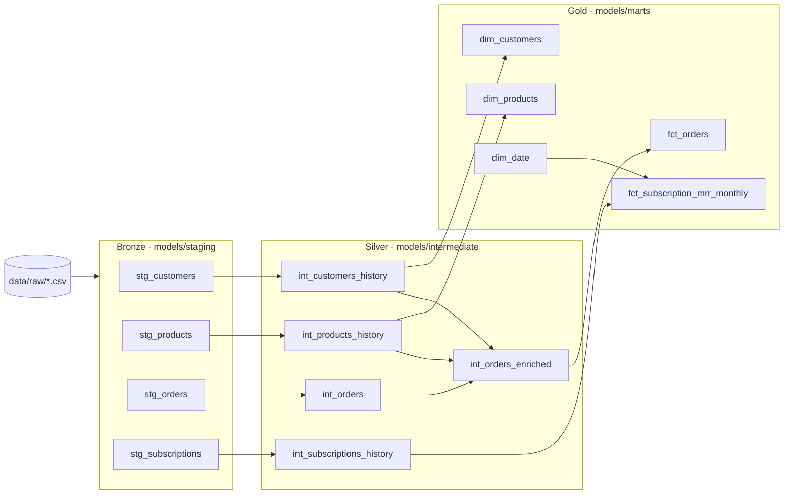

# ecom-data-modeling-project

A data modeling project for a fictional e-commerce business, built with dbt and DuckDB.

The raw data is synthetic. A Python script generates it with a realistic change history, including updates, corrections, late-arriving rows and duplicates, so the dbt models have to handle what real source extracts look like.

## Setup

Requires Python 3.11+ and [uv](https://docs.astral.sh/uv/). Dependencies are declared in `pyproject.toml` and pinned in `uv.lock`.

```bash
export UV_PROJECT_ENVIRONMENT=deenv   # put the virtualenv in ./deenv instead of ./.venv
uv sync                               # installs project + dev tools (ruff, flake8, black)
source deenv/bin/activate
```

Code quality checks:

```bash
ruff check .
flake8 scripts
black --check .
```

## Generating the raw data

```bash
python scripts/generate_raw_data.py
```

This writes four CSVs to `data/raw/`. The output is reproducible: the same `--seed` and options always produce the same files, so `data/` is not committed.

| Option | Default | Meaning |
|---|---|---|
| `--customers` | 1000 | Number of customers |
| `--products` | 80 | Number of products |
| `--orders` | 6000 | Number of orders |
| `--subscription-share` | 0.35 | Share of customers who start a subscription |
| `--start` / `--end` | 2024-01-01 / 2026-10-31 | Date range of the history |
| `--late-rate` | 0.03 | Share of rows that load 1–14 days late |
| `--dup-rate` | 0.01 | Share of rows delivered twice |
| `--seed` | 42 | Random seed |
| `--out-dir` | `data/raw` | Output folder |

Example for a larger dataset:

```bash
python scripts/generate_raw_data.py --customers 5000 --orders 30000 --seed 7
```

## The raw data

Each file is an append-only extract, as if copied nightly from the source system. Every change to a record is a **new row**; nothing is edited in place. To get the current state of a record you have to pick its latest version.

Every file has three metadata columns:

| Column | Meaning |
|---|---|
| `updated_at` | When the change happened in the source system |
| `_op` | `I` insert, `U` update, `D` delete |
| `_loaded_at` | When the row landed in the warehouse (a nightly batch around 02:00) |

### Files

| File | Key | One row per | Main columns |
|---|---|---|---|
| `customers.csv` | `customer_id` | customer version | name, email, phone, address, segment, marketing opt-in |
| `products.csv` | `product_id` | product version | SKU, name, category, unit price, active flag |
| `orders.csv` | `order_id` | order status change | customer, product, quantity, price, discount, total, status |
| `subscriptions.csv` | `subscription_id` | subscription version | customer, plan, billing period, MRR, status, start/cancel dates |

Orders contain one product each. Orders and subscriptions reference customers and products by ID.

### What's in the history

- **Updates:**
  - Customers move, change email, phone or last name, toggle marketing opt-in, and move up a segment.
  - Product prices change, and some products are discontinued.
  - Orders go `placed` → `shipped` → `delivered`, or are `cancelled`. Some are later `returned` or get a goodwill discount.
  - Subscriptions go `trialing` → `active`, upgrade or downgrade, become `past_due` or `paused`, and churn to `cancelled`. All live subscriptions are repriced once when plan prices go up.
- **Corrections:** a wrong value is written, then fixed. Examples are a product price with a shifted decimal point, typos in names, an uppercase email with spaces, a wrong state, an order with the wrong quantity, and a backdated subscription start date. About 30% of fixes have the **same `updated_at`** as the bad row, so only `_loaded_at` tells you which one is newer.
- **Late arrivals:** about 3% of rows load 1–14 days after they happened, so rows can arrive out of order.
- **Duplicates:** about 1% of rows are delivered twice, either identically or in a later batch.
- **Deletes:** about 2% of customers are hard-deleted (`_op = 'D'`), and their live subscriptions are cancelled first. A few discontinued products are deleted too.
- **Unfixed messy values:** some emails keep odd capitalization, phone formats vary, and about 5% of phones are missing.
- **Cutoff:** the data is an extract taken on the morning after `--end`. Anything not yet loaded by then is missing, so recent orders can still be open.

### Picking the latest version

To deduplicate, order each key's rows by `updated_at` and then `_loaded_at`, both descending. For example:

```sql
select *
from raw_customers
qualify row_number() over (
    partition by customer_id
    order by updated_at desc, _loaded_at desc
) = 1
```

Drop the result if that latest row has `_op = 'D'`.

## Architecture

The dbt project follows a medallion layout. Each layer is a folder under `models/` and a schema in `ecom.duckdb`.



| Layer | Schema | Built as | Grain | What happens |
|---|---|---|---|---|
| **Bronze** (staging) | `bronze` | views | one row per record change | Cast types, trim and standardize text (emails, phones, states), turn blanks into nulls, flag deletes. Deduplicate to one row per (key, `updated_at`), keeping the row loaded last, which removes duplicate deliveries and applies same-timestamp corrections. |
| **Silver** (intermediate) | `silver` | tables | one row per version / per order | Build SCD Type 2 history (`valid_from`, `valid_to`, `is_current`) with the `scd2_from_history` macro. Roll order changes up to one row per order with lifecycle timestamps. Join each order to the customer and product versions valid when it was placed. |
| **Gold** (marts) | `gold` | tables | see below | Star schema for analysis. |

Gold models:

| Model | Type | Grain |
|---|---|---|
| `dim_customers` | dimension, SCD2 | customer version |
| `dim_products` | dimension, SCD2 | product version |
| `dim_date` | dimension | day |
| `fct_orders` | fact | order (latest state), keyed to the dimension versions at order time |
| `fct_subscription_mrr_monthly` | periodic snapshot fact | subscription × month, as of month end |

### Key design choices

- **SCD2 is derived from the source history, not from dbt snapshots.** The extracts already contain every change with its timestamp, so versions are rebuilt from scratch on each run. Snapshots would only capture changes seen between dbt runs.
- **A version starts only when a tracked value changes.** Rows that repeat the same values are collapsed.
- **Deletes close the history.** A hard delete becomes a tombstone version in Silver. Gold removes it, so the customer's last version ends at the delete time and its history stays available for old orders.
- **Point-in-time joins.** `fct_orders.customer_sk` points to the customer as they were when the order was placed, such as their segment and state at that time. For current attributes, join `dim_customers` on `customer_id` with `is_current`.
- **MRR** counts only `active` and `past_due` subscriptions. Trials and paused subscriptions show 0.

### Where each data problem is handled

| Problem in the raw data | Handled in | How |
|---|---|---|
| Everything arrives as text | Bronze | Explicit casts to timestamp, date, decimal, integer and boolean |
| Blank strings, missing values | Bronze | `nullif(trim(x), '')`; missing country defaults to `US` |
| Messy emails | Bronze | Lowercased and trimmed |
| Many phone formats | Bronze | Digits only, US country code (`1` / `001`) removed, extension split into `phone_extension` |
| Duplicate deliveries | Bronze | One row per (key, `updated_at`), latest `_loaded_at` wins |
| Corrections with the same `updated_at` | Bronze | Same rule: the row loaded later is the fix |
| Corrections with a later `updated_at` | Silver | Become a new SCD2 version |
| Late-arriving rows | Silver | Versions are ordered by `updated_at`, not by load time |
| Hard deletes (`_op = 'D'`) | Silver → Gold | Tombstone version in Silver, removed in Gold; `deleted_at` kept on every version |
| Orders still open at the cutoff | Silver | `is_open` flag; lifecycle timestamps stay null |

## Model reference

### Bronze (`models/staging`)

| Model | Key | Notes |
|---|---|---|
| `stg_customers` | `customer_id`, `updated_at` | Keeps `phone_raw` next to the cleaned `phone_number`. `postal_code` stays text to keep leading zeros. |
| `stg_products` | `product_id`, `updated_at` | Price as `decimal(10,2)`. |
| `stg_orders` | `order_id`, `updated_at` | `status` renamed to `order_status`. |
| `stg_subscriptions` | `subscription_id`, `updated_at` | Date-only columns renamed `started_on`, `trial_ends_on`. |

Every Bronze model also has `source_operation` (the raw `_op`), `is_deleted` and `loaded_at`. The raw CSVs are read through the `raw` source in `models/staging/_sources.yml`.

### Silver (`models/intermediate`)

| Model | Grain | Notes |
|---|---|---|
| `int_customers_history` | customer version | SCD2 over name, email, phone, address, segment, marketing opt-in |
| `int_products_history` | product version | SCD2 over SKU, name, category, price, active flag |
| `int_subscriptions_history` | subscription version | SCD2 over plan, billing period, MRR, status, dates |
| `int_orders` | order | Latest state plus `shipped_at`, `delivered_at`, `cancelled_at`, `returned_at` (first time each status was reached), gross, discount and net amounts |
| `int_orders_enriched` | order | `int_orders` + `customer_sk`, `product_sk`, segment, state, category and list price at order time |

The three history models share these columns from the `scd2_from_history` macro:

| Column | Meaning |
|---|---|
| `*_sk` | Surrogate key of the version: hash of the record key and `valid_from` |
| `valid_from` / `valid_to` | When the version was true; `valid_to` is null for the latest version |
| `is_current` | Latest version of the record |
| `version_number` | 1, 2, 3 … per record |
| `is_deleted` | Tombstone version recording a delete |
| `deleted_at` | When the record was deleted, repeated on every version |

To track another column in the history, add it to `tracked_columns` in the model that calls the macro.

### Gold (`models/marts`)

| Model | Grain | Main columns |
|---|---|---|
| `dim_customers` | customer version | `customer_sk`, `customer_id`, `full_name`, contact and address, `customer_segment`, `valid_from`, `valid_to`, `is_current`, `is_deleted_customer` |
| `dim_products` | product version | `product_sk`, `product_id`, `sku`, `product_name`, `category`, `unit_price`, `is_active`, validity columns |
| `dim_date` | day | `date_key` (yyyymmdd), year, quarter, month, week, weekday, `is_weekend`. Range is set by the `date_spine_start` / `date_spine_end` vars in `dbt_project.yml`. |
| `fct_orders` | order | `customer_sk`, `product_sk`, `order_date_key`; quantity, prices, `gross_amount`, `discount_amount`, `net_amount`, `recognized_revenue` (0 if cancelled or returned); lifecycle timestamps, `days_to_ship`, `days_to_deliver` |
| `fct_subscription_mrr_monthly` | subscription × month | `month_start`, `customer_sk`, plan, status, `mrr`, `is_paying`. Cancelled subscriptions appear up to their cancellation month. |

## Tests

`dbt build` runs 56 tests along with the models:

- **Bronze:** not-null keys, one row per (key, `updated_at`), and allowed values for segments, categories, statuses, plans and payment methods.
- **Silver and Gold:** unique and not-null surrogate keys, and one row per order.
- **Relationships:** every fact key exists in its dimension (`customer_sk`, `product_sk`, date keys).
- **Custom tests** in `tests/`:
  - `assert_scd2_versions_are_valid`: no version ends before it starts, and no record has two open versions.
  - `assert_order_totals_reconcile`: `net_amount` = quantity × unit price × (1 − discount).
  - `tests/generic/unique_combination_of_columns`: a reusable test for composite keys.

## Example queries

Open the warehouse with `duckdb ecom.duckdb` or from Python with `duckdb.connect("ecom.duckdb")`.

Revenue by month and the customer segment at the time of the order:

```sql
select
    d.year, d.month,
    f.customer_segment_at_order,
    sum(f.recognized_revenue) as revenue
from gold.fct_orders f
join gold.dim_date d on d.date_key = f.order_date_key
group by all
order by all;
```

MRR and paying subscriptions per month:

```sql
select month_start, sum(mrr) as mrr, count(*) filter (where is_paying) as paying_subscriptions
from gold.fct_subscription_mrr_monthly
group by month_start
order by month_start;
```

A customer's full change history (C00516 has 6 versions, moving state and segment):

```sql
select version_number, email, state, customer_segment, valid_from, valid_to, is_current
from gold.dim_customers
where customer_id = 'C00516'
order by version_number;
```

## Running dbt

```bash
source deenv/bin/activate
python scripts/generate_raw_data.py   # if data/raw/ is empty
dbt build                             # build all models and run all tests
dbt docs generate && dbt docs serve   # browse model docs and lineage
```

`profiles.yml` in the project root points dbt at a local `ecom.duckdb` file, so no setup in `~/.dbt` is needed.

## Project layout

```
scripts/generate_raw_data.py   raw data generator
data/raw/                      generated CSVs (not committed)
models/staging/                Bronze: stg_* models and source definitions
models/intermediate/           Silver: SCD2 history and order logic
models/marts/                  Gold: dimensions and facts
macros/                        scd2_from_history, schema naming
tests/                         custom data tests
dbt_project.yml, profiles.yml  dbt configuration
pyproject.toml                 Python dependencies and tool config
uv.lock                        locked dependency versions
```
