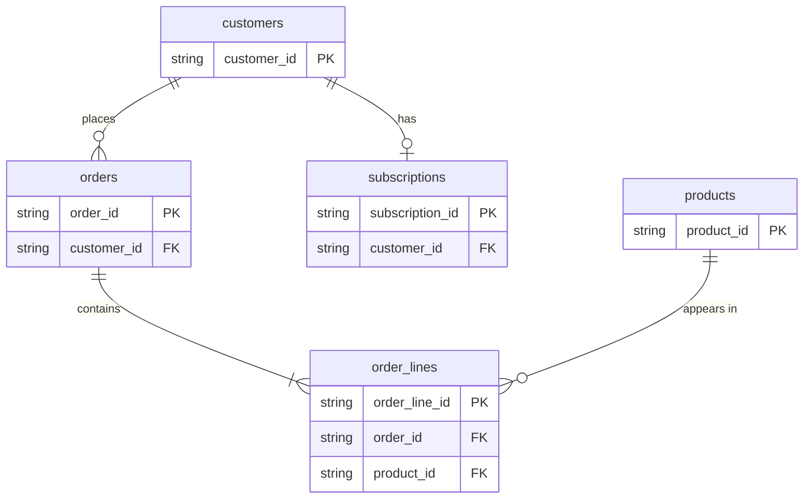

# Raw tables: how they connect

The generator writes five CSVs to `data/raw/`, which load into `raw.*`. Each
file is a **change log**: one row per version of a record, never an in-place
edit. The diagram shows only the keys; the full column lists follow it. Every
table also has the three metadata columns described below.

## Columns

The raw layer stores every column as text. The types below are what Bronze
casts them to.

### customers

| Column             | Type      | Notes                                  |
| ------------------ | --------- | -------------------------------------- |
| `customer_id`      | string    | PK, e.g. `C00001`                      |
| `first_name`       | string    |                                        |
| `last_name`        | string    |                                        |
| `email`            | string    |                                        |
| `phone`            | string    |                                        |
| `street_address`   | string    |                                        |
| `city`             | string    |                                        |
| `state`            | string    |                                        |
| `postal_code`      | string    |                                        |
| `country`          | string    |                                        |
| `customer_segment` | string    | consumer, small_business, enterprise   |
| `marketing_opt_in` | boolean   |                                        |
| `created_at`       | timestamp |                                        |

### products

| Column         | Type      | Notes              |
| -------------- | --------- | ------------------ |
| `product_id`   | string    | PK                 |
| `sku`          | string    | one SKU per product |
| `product_name` | string    |                    |
| `category`     | string    |                    |
| `unit_price`   | decimal   | changes over time  |
| `currency`     | string    |                    |
| `is_active`    | boolean   |                    |
| `created_at`   | timestamp |                    |

### orders

| Column            | Type      | Notes                                         |
| ----------------- | --------- | --------------------------------------------- |
| `order_id`        | string    | PK, e.g. `O000001`                            |
| `customer_id`     | string    | FK to `customers`                             |
| `order_total`     | decimal   | = sum of `line_total`                         |
| `currency`        | string    |                                               |
| `payment_method`  | string    |                                               |
| `status`          | string    | placed, shipped, delivered, cancelled, returned |
| `order_placed_at` | timestamp |                                               |

### order_lines

| Column          | Type    | Notes                          |
| --------------- | ------- | ------------------------------ |
| `order_line_id` | string  | PK, `order_id-line_number`     |
| `order_id`      | string  | FK to `orders`                 |
| `line_number`   | int     | 1 to 5                         |
| `product_id`    | string  | FK to `products`               |
| `quantity`      | int     |                                |
| `unit_price`    | decimal | product price on the order date |
| `discount_pct`  | decimal |                                |
| `line_total`    | decimal |                                |
| `line_status`   | string  | active, returned               |

### subscriptions

| Column            | Type      | Notes                 |
| ----------------- | --------- | --------------------- |
| `subscription_id` | string    | PK                    |
| `customer_id`     | string    | FK to `customers`     |
| `plan_name`       | string    | basic, plus, premium  |
| `billing_period`  | string    |                       |
| `mrr`             | decimal   |                       |
| `status`          | string    |                       |
| `started_at`      | timestamp |                       |
| `trial_ends_at`   | timestamp |                       |
| `cancelled_at`    | timestamp |                       |
| `created_at`      | timestamp |                       |

## Relationships

| From        | To              | Cardinality        | Join on       | Notes                                    |
| ----------- | --------------- | ------------------ | ------------- | ---------------------------------------- |
| `customers` | `orders`        | one to many        | `customer_id` | some customers never order               |
| `customers` | `subscriptions` | one to zero or one | `customer_id` | about a third of customers subscribe     |
| `orders`    | `order_lines`   | one to many        | `order_id`    | 1 to 5 lines per order                   |
| `products`  | `order_lines`   | one to many        | `product_id`  | a product appears once per order at most |

## Keys in a change log

The `PK` columns above identify a **record**, not a row. One customer has
many rows, one per version, so `customer_id` alone is not unique in raw.

| Key                            | Unique in raw? | What it identifies                          |
| ------------------------------ | -------------- | ------------------------------------------- |
| `<id>`                         | no             | the record (customer, order, ...)           |
| `<id>, updated_at`             | no             | one version, but a correction can share it  |
| `<id>, updated_at, _loaded_at` | no             | one delivery, but a duplicate can repeat it |

To get one row per version, Bronze (`stg_*`) keeps the row with the latest
`_loaded_at` for each `(<id>, updated_at)`. That removes duplicate deliveries
and lets a correction that reuses the bad row's `updated_at` win.

## Metadata columns (on every table)

| Column       | Meaning                                                      |
| ------------ | ------------------------------------------------------------ |
| `updated_at` | when the change happened in the source (event time)          |
| `_op`        | `I` insert, `U` update (full record after it), `D` delete    |
| `_loaded_at` | when the row landed in the warehouse (load time)             |

The loader adds three lineage columns in `raw.*`: `_ingested_at`,
`_batch_id` and `_file_name`.

## Known exceptions

- **Order headers ahead of their lines.** A few orders (4 with the default
  seed) have a header row in `orders` but no rows yet in `order_lines`. The
  order's insert (header and lines together) arrived late, after the
  extract, while a later status change had already loaded. The lines show
  up in a later load. The dbt test `assert_order_headers_have_lines` warns
  on these.
- **Foreign keys always resolve** in the generated data: every
  `orders.customer_id`, `subscriptions.customer_id` and
  `order_lines.product_id` exists in its parent table.
